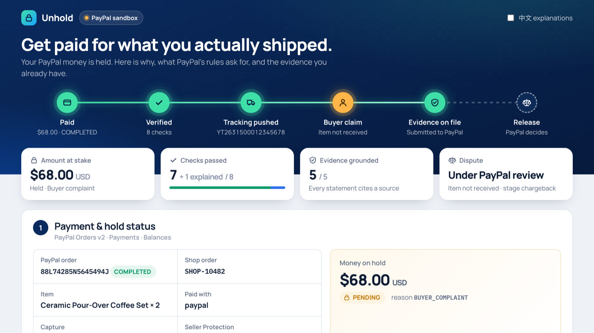
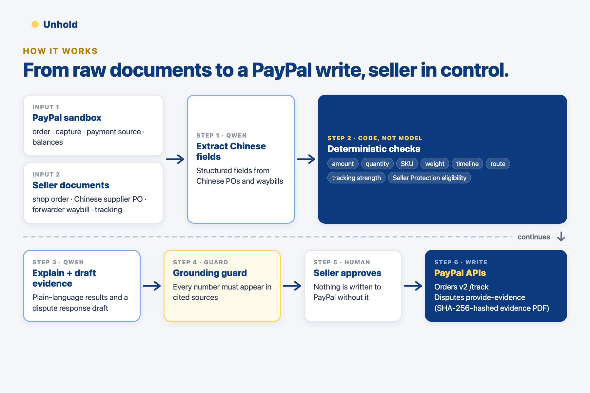

# Unhold — get paid for what you actually shipped



> **Live demo:** https://unhold-do43.onrender.com — runs on the PayPal sandbox with real API calls; each visitor gets a private workspace. Enter the access code from the Devpost testing instructions, then follow the 6-step guide on the page (create a test order → pay as the sandbox buyer → verify → push tracking → open a dispute as the buyer → submit evidence). The free instance sleeps when idle, so the first load can take ~30–50 s. To run it yourself instead, see [Run it](#run-it-judges-10-minutes).

**Unhold** is a get-paid copilot for small cross-border sellers (e.g. a two-person Shopify shop shipping to US buyers) who take payments with PayPal.

When PayPal holds a payment, the seller usually doesn't know *why*, *when* it will be released, or *what exactly* to do. Unhold reads the PayPal transaction, reads the seller's own documents (often not in English) — shop order, supplier purchase order, forwarder waybill, tracking feed — cross-checks them with deterministic code, explains the result in plain English (plus the seller's language) with an LLM, and then, **only after the seller approves**, executes the next step PayPal's own rules ask for:

1. **Explain the hold** — status from PayPal Orders/Payments/Balances APIs + the policy that applies (e.g. risk holds of up to 30 days for some seller regions; released ~24h after a supported carrier confirms delivery).
2. **Verify fulfillment** — amount, quantity, SKU, weight, timeline, route, tracking strength and Seller Protection eligibility, each traced back to a source document.
3. **Push tracking** — `POST /v2/checkout/orders/{id}/track` with the correct PayPal carrier code (e.g. `YUNEXPRESS`). Blocked if any check fails (e.g. an untracked economy parcel that can never show "delivered").
4. **Answer disputes with the same evidence** — reads the actions PayPal currently allows (HATEOAS links), builds a hashed, source-cited evidence PDF and submits it via the Disputes API (`provide-evidence`, or `provide-supporting-info` while PayPal is reviewing a claim).
5. **Ask about this case** — a Q&A panel that answers seller questions ("why is my money held?", "am I covered by Seller Protection?", "what's my dispute fee?") using only this case's live PayPal data and 20 verbatim PayPal policy excerpts (`data/policy_corpus.json`), with citation chips linking to the source. Uncited claims are dropped; out-of-scope questions are declined.

## Why this problem

- "Trouble accessing funds in your mobile or digital wallet" is the #1 non-fraud PayPal issue in the US CFPB complaint database: 1,259 complaints in 2025 and 1,980 in 2026 through Nov 13 (~17% of PayPal complaints).
- PayPal's User Agreement (Hong Kong / China seller accounts): *"Risk-based holds generally remain in place for up to 30 days"*; releasing earlier depends on uploaded tracking and confirmed delivery.
- Seller Protection requires online tracking showing "delivered" to the transaction address, and does **not** cover Guest Checkout / card payments when the seller is registered in China, Hong Kong or Singapore.
- Small sellers already hold the facts (orders, purchase records, waybills, tracking) — but often not in English, scattered across tools, and they surface only after a dispute starts, inside a 10-day response window.



## How PayPal and AI are used

| Tool | What it does in Unhold |
|---|---|
| PayPal **Orders v2** | create/capture the sandbox order; read payment source & shipping address; **add tracking** (`/track`) |
| PayPal **Payments / Balances / Transaction Search** | read capture status, `status_details`, withheld balance for hold diagnosis |
| PayPal **Disputes v1** | list/get disputes, read allowed actions (HATEOAS), **provide-evidence** / **provide-supporting-info** (multipart PDF), escalate, sandbox `require-evidence` / `adjudicate` |
| PayPal **sandbox** | everything runs against `api-m.sandbox.paypal.com` |
| **Qwen (Alibaba Cloud Model Studio / Bailian)**, `qwen3.8-flash` via the OpenAI-compatible endpoint | (1) extracts structured fields from supplier documents in other languages (the demo PO is in Chinese); (2) explains each check and the hold in English, with an optional second language; (3) drafts English evidence statements with source citations |

**Guardrails (compliance by design)**

- The LLM never decides pass/fail — deterministic code does.
- **Grounding guard:** every evidence sentence must cite known source documents and every number in it must appear in those sources; otherwise it is blocked and not submitted.
- **Human approval** before every write (tracking, evidence) + an append-only audit log (`out/audit.log.jsonl`).
- **PII minimisation:** buyer name and street are never sent to the LLM (only city/state/ZIP).
- Only official REST APIs — no automation of PayPal web pages.
- Unhold never claims to release funds; PayPal decides. It does what PayPal's rules say unlocks funds.

## Run it (judges: ~10 minutes)

Everything runs locally against the **PayPal sandbox** — no PayPal calls are mocked. Only the seller's own documents in `data/docs/` (supplier PO, forwarder waybill, tracking feed) are mock data, clearly labelled.

### 0. Prerequisites

| You need | Where to get it |
|---|---|
| **Node.js ≥ 22.9** (tested on 25) | https://nodejs.org — no npm dependencies; `npm install` downloads nothing |
| **PayPal sandbox app** (Client ID + Secret) | [developer.paypal.com](https://developer.paypal.com/dashboard/applications/sandbox) → *Apps & Credentials* → **Sandbox** → *Create App* (type: Merchant). Copy Client ID and Secret. |
| **Sandbox buyer account** (to pay and open a dispute) | Developer Dashboard → *Testing Tools* → **Sandbox Accounts**. Use the default *Personal* account, or *Create account* → Personal, **country: United States** (some regions can't send payments in sandbox). Click the account → *View/Edit* to see its email and password. |
| **Qwen API key** (Alibaba Cloud Model Studio / DashScope) | [Model Studio console](https://bailian.console.aliyun.com/) (China region) or [international console](https://modelstudio.console.alibabacloud.com/) → *API Keys*. |

### 1. Install and configure

```bash
git clone https://github.com/YihuiZhou-zyh/unhold.git && cd unhold
npm install
cp .env.example .env
```

Edit `.env`:

```bash
PAYPAL_CLIENT_ID=...            # sandbox app
PAYPAL_CLIENT_SECRET=...
PAYPAL_ENVIRONMENT=SANDBOX
DASHSCOPE_API_KEY=sk-...
# International (Singapore) Model Studio account? Also set:
# DASHSCOPE_BASE_URL=https://dashscope-intl.aliyuncs.com/compatible-mode/v1
# If qwen3.8-flash isn't enabled for your account, use any Qwen chat model you have, e.g.:
# QWEN_MODEL=qwen-plus
```

### 2. Create a sandbox order and pay it

```bash
npm run create-order
# ORDER 8YT75534VX564554M PAYER_ACTION_REQUIRED
# APPROVE_URL https://www.sandbox.paypal.com/checkoutnow?token=8YT75534VX564554M
npm start
# Unhold running on http://localhost:3000
```

Open the `APPROVE_URL`, log in with the **sandbox Personal (buyer)** account and click *Pay*. PayPal redirects to `http://localhost:3000/return`, which captures the payment. (If the redirect doesn't load, open http://localhost:3000 and click **Capture payment**.)

> You can already click **Run verification** before paying — the checks read the order; only *add tracking* and disputes need a captured payment.

### 3. Explain the hold and verify the shipment

Open **http://localhost:3000** (use `localhost` or `127.0.0.1`; other host names are rejected on purpose).

1. The top card shows the live PayPal order / capture status and the hold rule that applies.
2. Click **Run verification** (~20 s; Qwen reads the non-English supplier PO and explains each check). Expect 8 check cards: amount, quantity, SKU, weight (*explained* — packaging), timeline, route, tracking strength, Seller Protection — plus the **grounding guard** panel showing every evidence sentence with its sources.
3. Tick **Contrast case: untracked economy parcel** and run again: *tracking strength* fails and tracking push is **blocked**. Untick and run again to continue.

### 4. Push tracking to PayPal (real write)

Click **Approve & add tracking**, then **Click again to confirm**. Unhold calls `POST /v2/checkout/orders/{id}/track` with carrier `YUNEXPRESS`. You can see the tracking number on the buyer side in sandbox (buyer's *Activity* → the payment). Every write is logged in `out/audit.log.jsonl`.

### 5. Open a dispute as the buyer and answer it (real write)

1. Log in to **https://www.sandbox.paypal.com** as the sandbox buyer → *Activity* → the $68 payment → **Report a problem** → *I didn't receive an item I bought* (Item not received) → submit.
2. Wait 1–5 minutes (sandbox disputes take a moment to appear in the API), then reload Unhold. The case appears in section **4 · Answer a dispute with the same evidence** → click **Open case**.
3. Click **Approve & submit evidence** → **Click again to confirm**. Unhold reads which actions PayPal currently allows for the case (HATEOAS links) and submits the hashed evidence PDF via `provide-evidence` or `provide-supporting-info`. Open http://localhost:3000/evidence.pdf to see exactly what was sent.
4. Optional sandbox helpers on the case card: *Escalate to PayPal review*, *Move to "waiting for seller evidence"*, *Adjudicate*. PayPal only accepts each of these in certain dispute states; if it refuses, Unhold shows PayPal's error (e.g. `ACTION_NOT_ALLOWED_IN_CURRENT_DISPUTE_STATE`).

### 6. Ask about the case

Click the **Ask Unhold** button (bottom right) and try *"Why is my money held?"*, *"Am I covered by Seller Protection?"* or *"What's my dispute fee?"*. Answers use only this case's live PayPal data and 20 verbatim PayPal policy excerpts (`data/policy_corpus.json`); each claim has a citation chip.

### Troubleshooting

| Symptom | Fix |
|---|---|
| `401` / `invalid_client` from PayPal | Use the **Sandbox** (not Live) Client ID/Secret; check `PAYPAL_ENVIRONMENT=SANDBOX`. |
| Buyer can't pay ("your account doesn't support this") | Use a sandbox Personal account with country **United States**. |
| Qwen errors (`401`, `model not found`) | Check `DASHSCOPE_API_KEY`; international accounts need `DASHSCOPE_BASE_URL` (see step 1); try `QWEN_MODEL=qwen-plus`. |
| Port 3000 in use | `PORT=3100 npm run create-order` and `PORT=3100 npm start` (the PayPal return URL follows `PORT`). |
| `bad host` | Open `http://localhost:<port>` or `http://127.0.0.1:<port>`. |
| Dispute doesn't appear | Wait a few minutes and reload; it must be opened on the same order created by `npm run create-order`. |
| Start over with a new order | Delete `out/state.json` and run `npm run create-order` again. |

Verified end-to-end in sandbox on 2026-11-12: order captured → tracking `YUNEXPRESS` added (visible on the buyer's case page) → buyer opened an Item-not-received claim → evidence PDF submitted and on file while PayPal reviews. Re-verified from a fresh clone on 2026-11-13.

## Hosted demo mode (Render)

The same server runs as a shared, judge-friendly demo when `PUBLIC_URL` (or Render's `RENDER_EXTERNAL_URL`) and `DEMO_ACCESS_CODE` are set:

- **Access code** page in front of everything (`DEMO_ACCESS_CODE`, at least 12 characters; the server refuses to start otherwise). API keys never leave the server. Wrong codes are limited per client IP (10 per 15 min, recorded before any async work so parallel requests can't race past it); `X-Forwarded-For` is trusted only behind Render (`RENDER`) or with `TRUST_PROXY=1`.
- **Private workspace per visitor** (cookie session): own order, analysis, tracking, evidence PDF and audit log. Dispute lists are filtered to the visitor's own payment (`disputed_transaction_id`), and dispute actions are refused for any other case.
- **Create test order** button in the UI (no CLI), with the sandbox buyer login shown to logged-in visitors (`SANDBOX_BUYER_EMAIL` / `SANDBOX_BUYER_PASSWORD`, sandbox-only test credentials).
- **Rate limits** per visitor and per day on order creation, Qwen analysis and Q&A.
- **Session capacity**: up to 500 workspaces; one source (IP, or IPv6 /64) keeps at most 5 (its own oldest is replaced only if idle > 30 min) and creates at most 10 per hour. At capacity, workspaces idle > 24 h are evicted first, then the least recently used one idle > 30 min; active workspaces are never evicted.
- `/healthz` for the platform health check; local mode (no `PUBLIC_URL`) is unchanged.

Deploy: Render Dashboard → **New → Blueprint** → this repo (uses `render.yaml`) → fill `PAYPAL_CLIENT_ID`, `PAYPAL_CLIENT_SECRET`, `DASHSCOPE_API_KEY`, `DEMO_ACCESS_CODE`, `SANDBOX_BUYER_EMAIL`, `SANDBOX_BUYER_PASSWORD`. The free plan sleeps when idle, so the first request can take ~30–50 s.

## Project layout

```
src/paypal.js   PayPal REST client (Orders, Payments, Balances, Transactions, Disputes)
src/verify.js   deterministic cross-checks + SHA-256 of source documents
src/ai.js       Qwen calls (extraction, explanation, evidence drafting) + grounding guard
src/pdf.js      dependency-free evidence PDF writer
src/server.js   web app + API, approval gates, audit log; hosted mode (access code, per-visitor workspaces, rate limits)
public/         single-page UI
data/           mock shop order and seller documents
```

## Limitations

- The sandbox cannot show a real hold being released; Unhold shows status and the rule, not a release.
- Tracking events are mock; a production build would call a tracking provider.
- Small sellers rarely hold per-parcel customs declarations (9610 parcels are declared by forwarders/postal operators), so customs documents are optional evidence, not required.

## License

MIT
